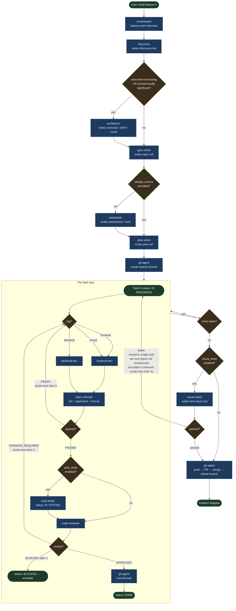
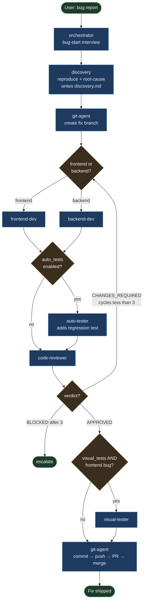
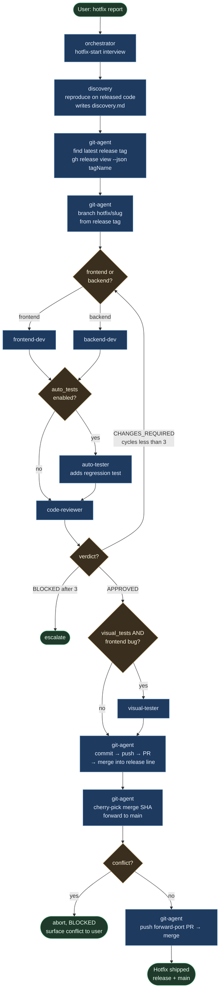

# Skill-Stack Workflow

How the custom skills in `.claude/skills/` hand off to ship a feature or a bugfix end to end. Triggered when a user invokes the orchestrator with a feature request (`/orchestrator build X`) or a bug report — the orchestrator runs the appropriate sub-flow below. Source of truth: [`.claude/skills/_playbook.md`](../../.claude/skills/_playbook.md); this page is the visual companion.

## Feature flow

## Bugfix flow

## Hotfix flow

Same loop as bugfix, with two deltas: branch cut from the latest release
tag (not `main`), and a cherry-pick of the merge commit forward to `main`
after the release-line merge. Full command recipe in
[`.claude/skills/git-agent/references/hotfix.md`](../../.claude/skills/git-agent/references/hotfix.md).

## Legend

- **Blue rounded box** — agent skill from `.claude/skills/`. Each is a leaf subagent dispatched by the orchestrator.
- **Amber diamond** — decision the orchestrator makes from `feature.json` flags or subagent verdicts.
- **Green pill** — terminal state.

## Skill ownership at a glance

| Skill | Owns |
|---|---|
| `orchestrator` | Top-level driver; runs the interview, dispatches every phase, updates `feature.json`, renders the dashboard. Never writes implementation code. |
| `discovery` | Greps the codebase + researches external libs. Produces `discovery.md`. |
| `architector` | Architecture intake, ADRs, Mermaid C4 diagrams. Produces `docs/architecture/overview.md`, `decisions/ADR-NNNN-*.md`, `diagrams/*.mmd`. |
| `spec-writer` | Problem / goals / non-goals / requirements / acceptance criteria. Produces `spec.md`. |
| `wireframer` | Standalone HTML/CSS mockups, one per screen. Produces `wireframes/*.html`. |
| `plan-writer` | Decomposes the spec into tagged tasks. Produces `plan.md`. |
| `frontend-dev` / `backend-dev` | Implements one task end-to-end against its acceptance criteria. |
| `auto-tester` | Writes + runs unit/integration tests for the just-implemented task. |
| `code-reviewer` | Reviews the diff for one task. Returns APPROVED or CHANGES_REQUIRED. Appends to `review.md`. |
| `visual-tester` | Drives the running dev server with Playwright across 3 breakpoints. Produces `test-report.md`. |
| `git-agent` | Owns all `git` and `gh` commands: branch, commits, push, PR, merge. |
| `static-checker` | Runs lint + typecheck + formatter in read-only mode per task. Produces a section in `test-report.md`. |
| `security-reviewer` | Diff-based OWASP / secrets / authz review per task. Appends a security section to `review.md`. |
| `a11y-auditor` | Runs axe-core against the dev server; reports WCAG AA failures. Produces a section in `test-report.md`. |
| `dependency-auditor` | npm / pip / cargo / go audit + license check, once per feature. Produces a section in `test-report.md`. |
| `release-manager` | Conventional-commit → semver bump + Keep-a-Changelog entry. Stages `CHANGELOG.md` and the manifest version. |
| `db-migrator` | Owns the project's migration files. Enforces reversibility and zero-downtime patterns. Writes the migration file. |

## Skip conditions

- **architector** skipped when `overview.md` exists AND user did not flag the feature as architecturally significant.
- **wireframer** skipped when `feature.json.design_source` is set (existing design provided).
- **auto-tester** skipped when `feature.json.auto_tests == false`.
- **visual-tester** skipped when `feature.json.visual_tests == false`.

## Loop limits

- Per task: max **3** implementer ↔ reviewer cycles before the task is marked `[BLOCKED]` and escalated to the user.
- Per feature: max **3** implementer ↔ visual-tester cycles before the same.
