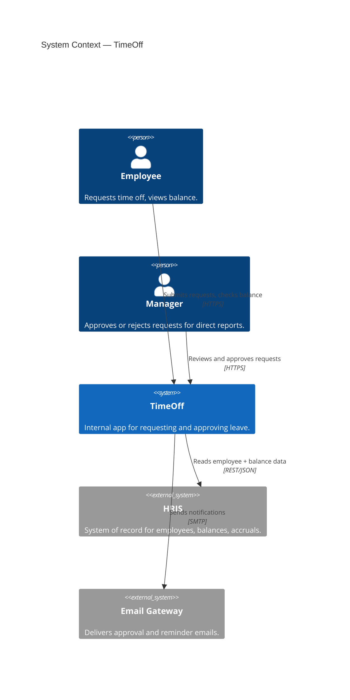
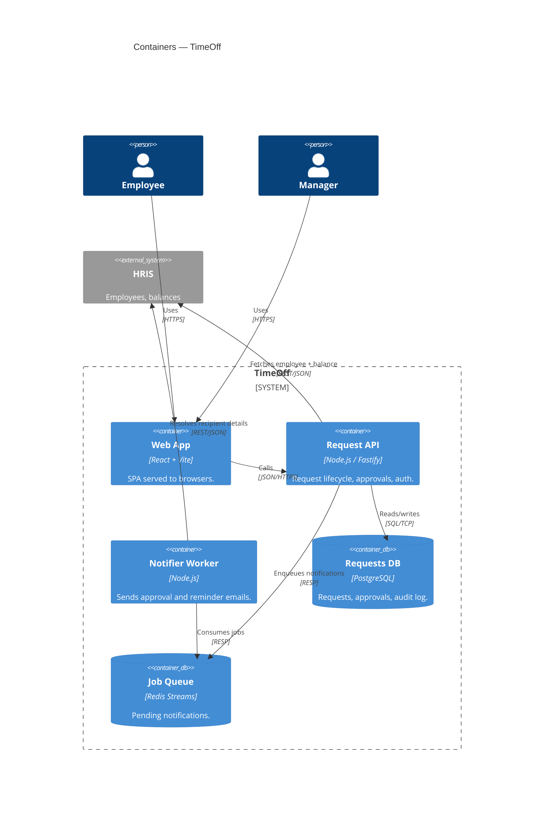
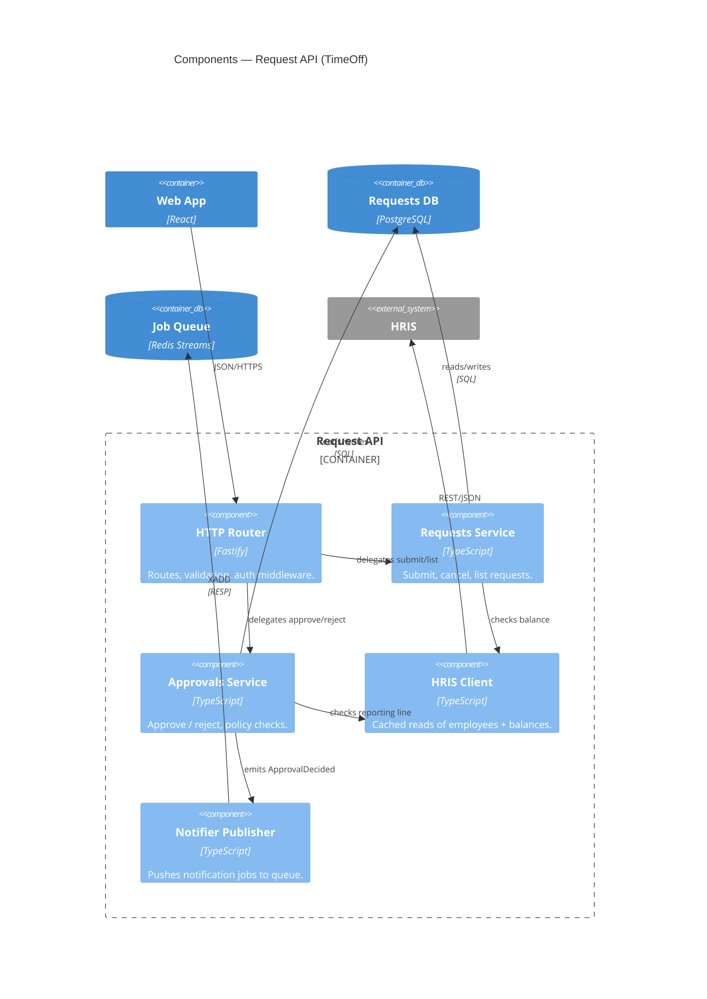

# Mermaid C4 Recipes

Three copy-pasteable Mermaid blocks for the C4 levels we draw most often. All
three describe the same example system — **TimeOff**, an internal time-off
request app — so you can see how a single domain decomposes from system
context down to a single container's components.

Render in any Mermaid 10+ environment. Keep each diagram below ~30 lines: if
it grows past that, you are mixing levels.

## C4Context — system in its world

Reach for `C4Context` first. It shows **who** uses the system and **what**
external systems it touches. No internal structure. One box per system.

## C4Container — inside the system

Use `C4Container` to zoom into one system. Wrap the internals in a
`System_Boundary`. Containers are independently deployable units (apps, APIs,
databases, queues). Use `ContainerDb` for stores.

## C4Component — inside one container

Use `C4Component` to show the **internal structure of a single container**.
Below: the Request API. Components are classes, modules, or packages — not
deploy units. Show internal `Rel`s; collapse external systems to a single box.

