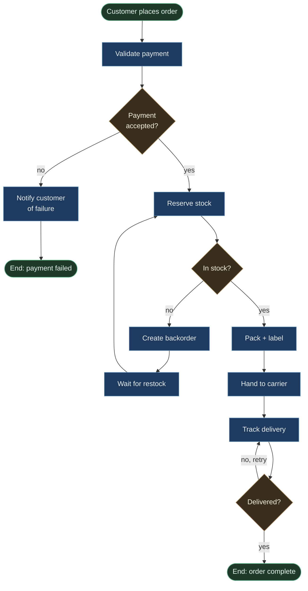
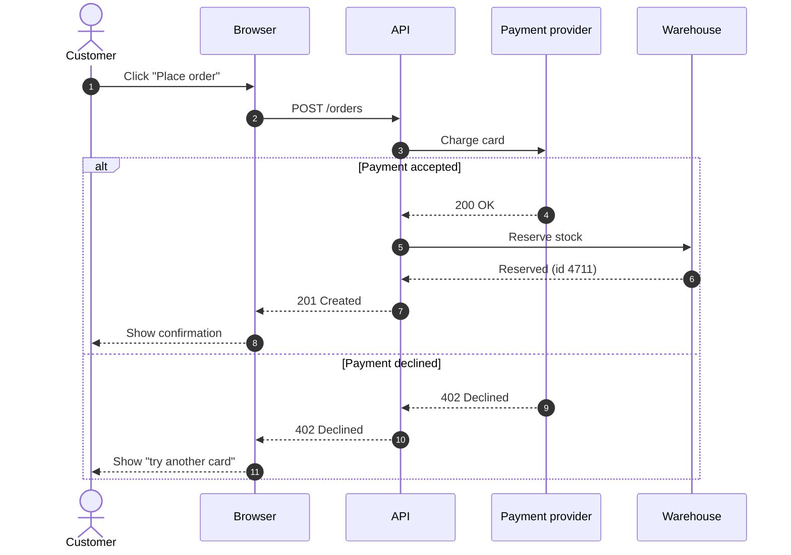
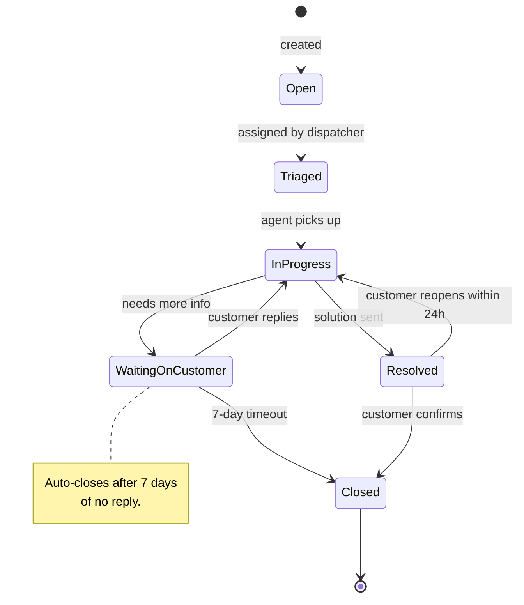

# Mermaid Workflow Recipes

Three copy-pasteable Mermaid blocks for the diagram types we reach for when documenting business or work processes. Pick one per workflow — don't try to use all three for the same diagram.

## When to reach for which

| Diagram type | Best for |
|---|---|
| `flowchart TD` / `flowchart LR` | Step-by-step processes with decisions, loops, parallel paths. The default for "how does X get done?" |
| `sequenceDiagram` | Multi-actor handoffs ordered in time. Best when "who calls whom" matters more than the steps themselves (e.g. service-to-service requests, support escalation across teams). |
| `stateDiagram-v2` | An entity that moves through a finite set of states (e.g. ticket: `open → triaged → in-progress → resolved → closed`, with reopen loops). |

Sizing budget: keep each block ≤ 50 non-blank lines. If a block grows past 50, split into sub-diagrams (one per phase) and either stack them in the same `.md` under separate H2s (up to 3 related sub-flows) or split into sibling `.md` files when the sub-flows are independent.

## Recipe 1 — `flowchart TD` (process with decisions + loop)

Use for: order fulfilment, support ticket lifecycle, deployment process, the agent-stack workflow.



Notes:
- Use `<br/>` inside node labels to wrap long text. Avoid `<` and `>` in edge labels — escape as words ("less than 3").
- The `classDef` palette at the bottom is the project's house style: blue = action, amber = decision, green = terminal. Reuse it across workflow diagrams for consistency.
- For left-to-right reading, swap `flowchart TD` for `flowchart LR`.

## Recipe 2 — `sequenceDiagram` (multi-actor handoff)

Use for: incident response across on-call → SRE → vendor; support escalation; checkout flow across browser → API → payment provider → fulfilment.



Notes:
- `autonumber` adds step numbers — useful for referring to "step 5" in prose.
- `actor` draws a stick figure; `participant` draws a box. Use `actor` for humans, `participant` for systems.
- `alt / else / end` shows branching; `loop` shows repetition; `par / and / end` shows parallel.
- Keep messages short — long labels make the rendered SVG awkwardly wide.

## Recipe 3 — `stateDiagram-v2` (entity lifecycle)

Use for: ticket states, subscription billing states, document review states, hardware device states.



Notes:
- `[*]` is the initial / final state — use it as both start and end markers.
- Transitions can carry labels after `:` to describe what triggered them.
- Use `note right of <state>` (or `left of`) sparingly — too many notes clutter the rendering.
- `stateDiagram-v2` is a different parser from the legacy `stateDiagram` — always use `-v2`.

## House styling

If you want all workflow diagrams across the repo to share visual language, use this palette consistently in `flowchart` blocks:

```
classDef action fill:#1e3a5f,stroke:#5b8cb8,color:#e8f1ff
classDef decision fill:#3a2f1e,stroke:#b89968,color:#fff5e0
classDef terminal fill:#1f3a2a,stroke:#5fb88c,color:#e8ffef
```

Apply with `class NodeA,NodeB action` lines below the `classDef` block. `sequenceDiagram` and `stateDiagram-v2` don't use `classDef` — they have their own theming via `%%{init: ...}%%` directives, but for consistency just rely on the renderer's default theme.

## Common pitfalls

- **Using `<` or `>` in edge labels** — these get parsed as HTML and break rendering. Write "less than 3" or "greater than 5" as words.
- **Subgraphs inside `sequenceDiagram`** — not supported. If you need grouping, use multiple `sequenceDiagram` blocks instead.
- **Mixing diagram types in one block** — illegal. One block, one diagram type.
- **Forgetting `[*]` in stateDiagram** — without it, the parser still renders, but readers can't tell where the lifecycle starts/ends.
- **Edge labels with newlines** — use `<br/>` (works on GitHub) rather than literal `\n` (doesn't).
